# Spotify Folia

**Turn Spotify playback into a fullscreen animated lyric stage.**

Spotify Folia is a Spicetify Custom App combining synchronized lyrics,
customizable visuals, animated backgrounds, an English lyric-PV stage,
and the embedded JIZURA engine inside Spotify desktop.

> Independent community project. Not affiliated with, endorsed by, or sponsored
> by Spotify, Spicetify, Folia, or JIZURA.

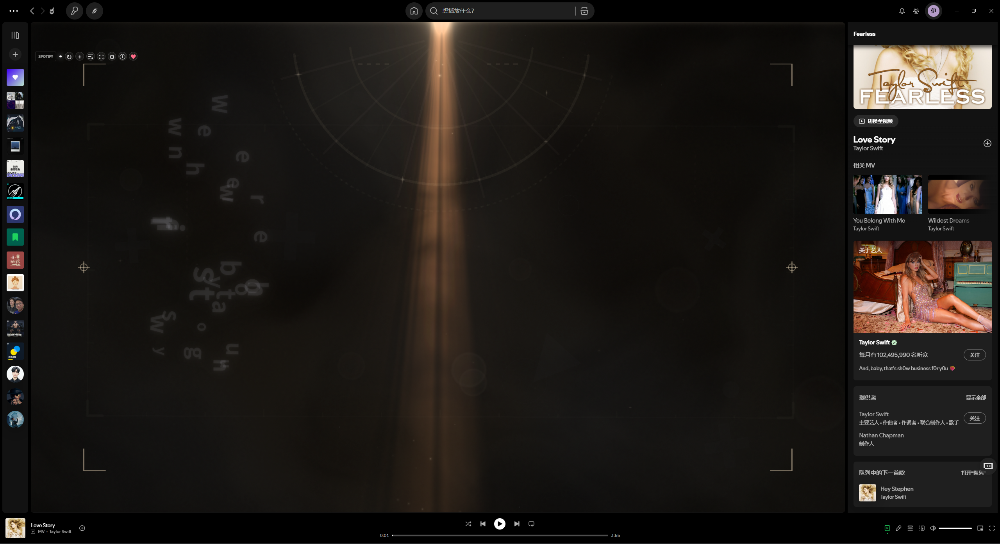

**[Watch the demo](#video-demos)**
&nbsp;|&nbsp; **[Download the latest release](https://github.com/m1570908333/spotify-folia/releases/latest)**

Screenshots below show the app running in Spotify. Spotify's surrounding
interface follows the user's language; Spotify Folia's controls are in English.

## Contents

- [Highlights](#highlights)
- [Video Demos](#video-demos)
- [Requirements](#requirements)
- [Installation](#installation)
- [First Launch](#first-launch)
- [Interface](#interface)
- [Stage Gallery](#stage-gallery)
- [Backgrounds and Customization](#backgrounds-and-customization)
- [Lyrics and Timing](#lyrics-and-timing)
- [JIZURA Workspace](#jizura-workspace)
- [Updates](#updates)
- [Troubleshooting](#troubleshooting)
- [Limitations](#limitations)
- [Privacy](#privacy)
- [Support](#support)
- [Development](#development)
- [Credits and Licensing](#credits-and-licensing)

## Highlights

- **12 stage modes**, including English Stage and JIZURA.
- **Fullscreen playback**, or a stage inside Spotify's central content area.
- **Multiple lyric sources:** local imports, Spotify, LRCLIB, and NetEase Cloud Music.
- **Customizable presentation:** typography, colors, subtitles, backgrounds,
  and mode-specific controls.
- **Lyric editing:** per-track offsets and editable word segmentation.
- **JIZURA tools:** native effects, line/cut overrides, project import/export,
  undo/redo, local audio analysis, and supported offline exports.
- **English interface**, with PowerShell installation and release updates.

## Video Demos

Watch the complete demo below without leaving GitHub. This 720p preview runs
for approximately two minutes and five seconds.

https://github.com/user-attachments/assets/a12d7b34-3b33-405d-839d-d0b2ae0c6e59

## Requirements

| Requirement | Notes |
| --- | --- |
| Windows 10 or 11 | The supplied installation scripts target Windows |
| Spotify desktop | Not the web player or mobile app |
| Configured Spicetify CLI | Spicetify must already work with your Spotify installation |
| Internet access | Release downloads and online lyric matching require connectivity |
| Graphics support | Canvas, WebGL, and hardware acceleration affect visual performance |

Configure Spicetify using its [official documentation](https://spicetify.app/docs/getting-started)
before installing Folia. The Folia installer does not install Spicetify for you.
Git and Node.js are not required for normal release installation.

## Installation

Open a regular PowerShell window and run:

```powershell
irm https://raw.githubusercontent.com/m1570908333/spotify-folia/main/scripts/install.ps1 | iex
```

This release command works from any directory. You do not need to clone the
repository or open a project folder.

The installer:

1. Finds the latest public Spotify Folia GitHub Release.
2. Downloads `spotify-folia.zip` and its SHA-256 checksum.
3. Verifies the archive against the published checksum.
4. Copies the Custom App into Spicetify's `CustomApps/folia-stage` directory.
5. Registers `folia-stage` while preserving the existing app list.
6. Runs `spicetify apply`.

Restart Spotify if Folia does not appear after installation.

> This command downloads and executes a script. Review
> [`scripts/install.ps1`](scripts/install.ps1) before running it. The checksum
> detects a mismatched download; it is not an independent publisher signature.

## First Launch

1. Open Spotify desktop and play a track.
2. Open **Spotify Folia** from Spotify's navigation area.
3. Wait for lyric matching, or click **+** to import a local lyric file.
4. Open **Settings** and choose a stage mode.
5. Adjust its appearance, then use **Fullscreen** to expand the stage.

Spotify's own playback bar handles playback and seeking. Folia does not add a
second progress bar to the stage.

## Interface

<details>
<summary><strong>View the stage and toolbar screenshot</strong></summary>

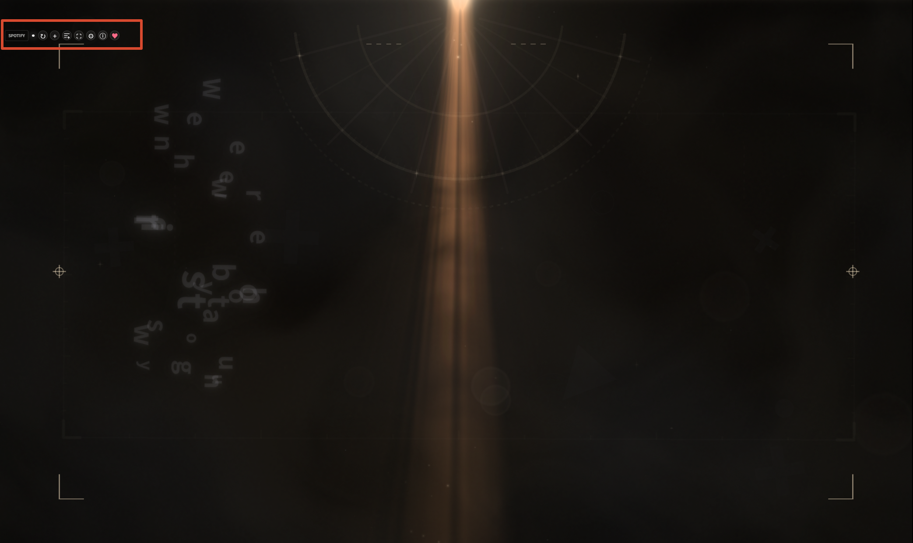

</details>

| Control | Action |
| --- | --- |
| Search again | Retry lyric matching for the current track |
| + | Import a local lyric file |
| Lyric segmentation icon | Edit word grouping; available when lyrics are loaded |
| Fullscreen | Expand or leave the fullscreen stage |
| Settings | Select a stage and adjust its appearance |
| Version information | View Spotify Folia's version and check for a newer release |
| Support this project | Open the built-in sponsor card |

Hover over an icon for its tooltip. Available settings depend on the stage and
the information supplied by the lyric source.

## Stage Gallery

Choose a mode in **Settings > Stage mode**. There are 12 modes; the gallery
shows the 11 modes with screenshots currently available. Click an image to
inspect it at full resolution. Colors, typography, and composition vary with
your settings and the current lyrics.

| JIZURA | Flow |
| :---: | :---: |
| [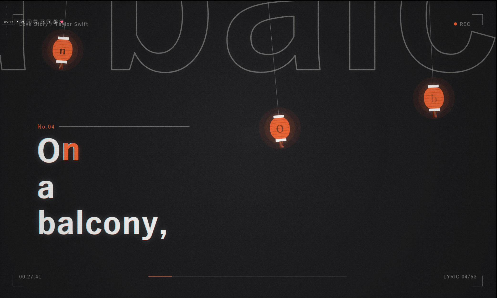](docs/media/jizura.png) | [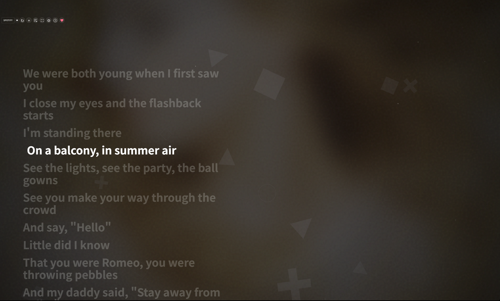](docs/media/flow.png) |

| Poster | Cappella |
| :---: | :---: |
| [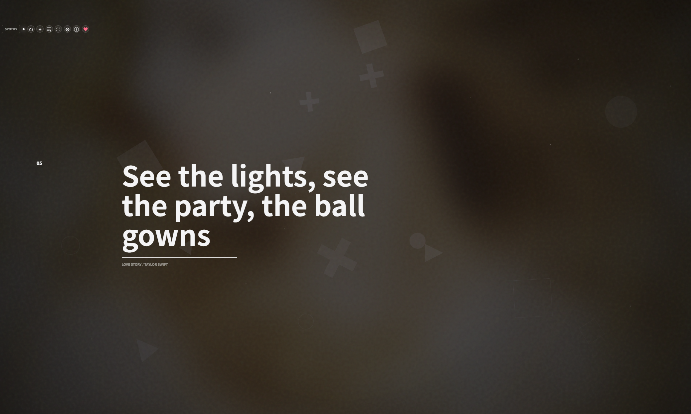](docs/media/poster.png) | [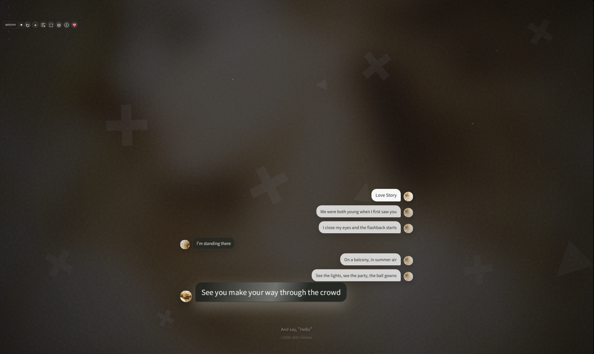](docs/media/cappella.png) |

| Claddagh | Monet |
| :---: | :---: |
| [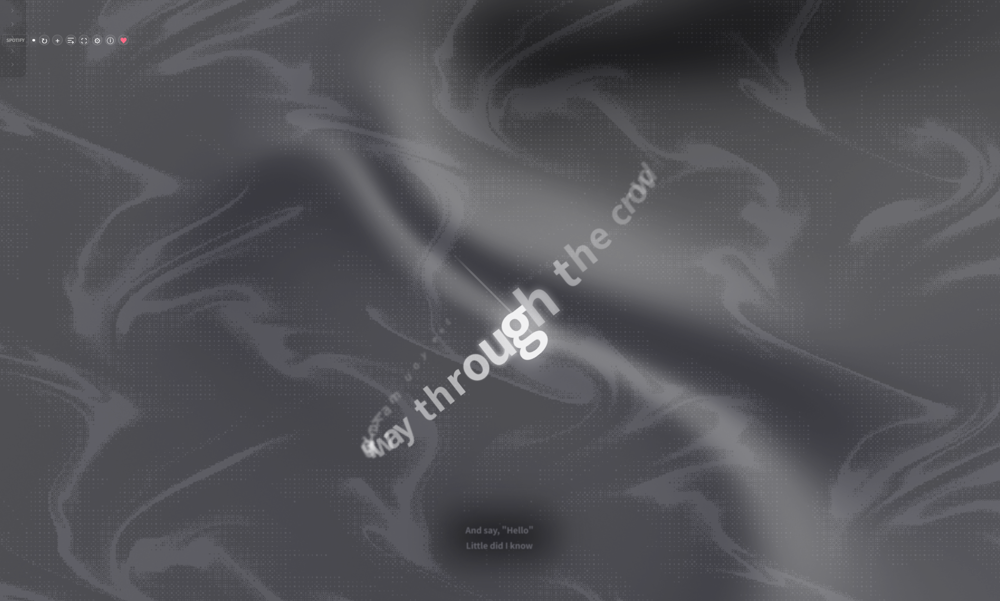](docs/media/claddagh.png) | [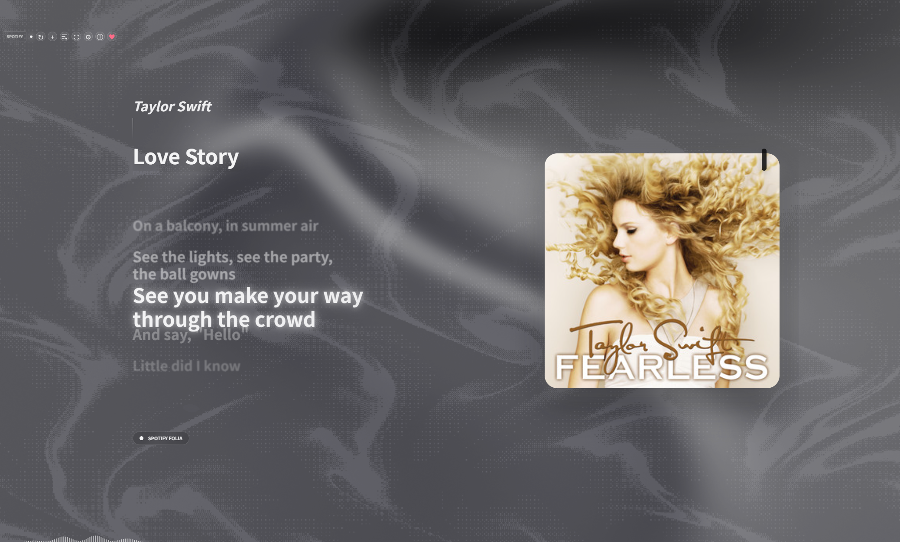](docs/media/monet.png) |

| Pendolo | Diorama |
| :---: | :---: |
| [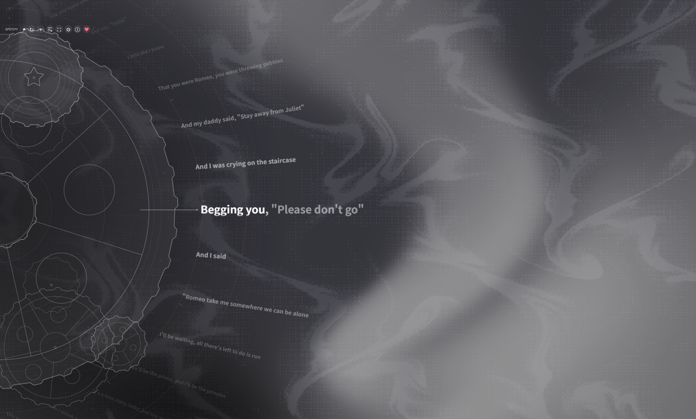](docs/media/pendolo.png) | [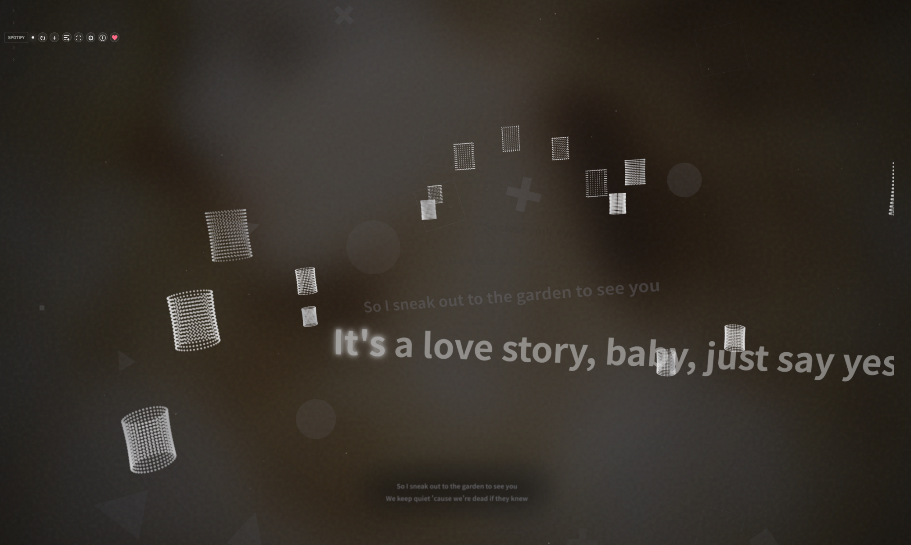](docs/media/diorama.png) |

| Sonnet | Tempera |
| :---: | :---: |
| [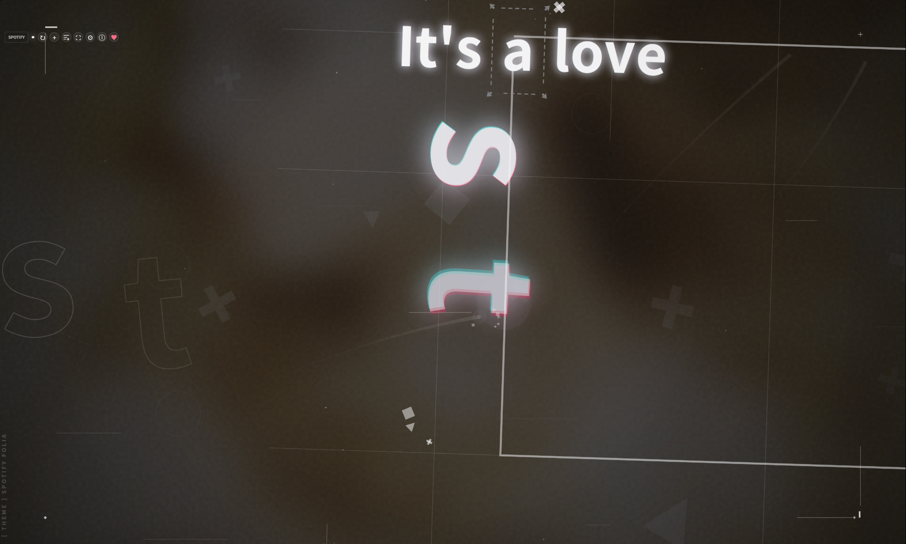](docs/media/sonnet.png) | [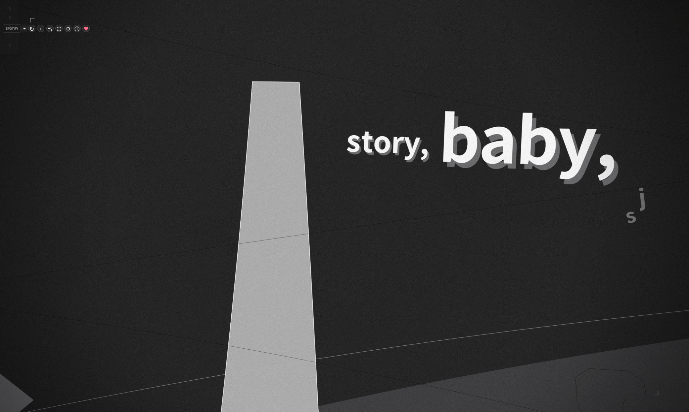](docs/media/tempera.png) |

<details>
<summary><strong>Lumiere</strong></summary>

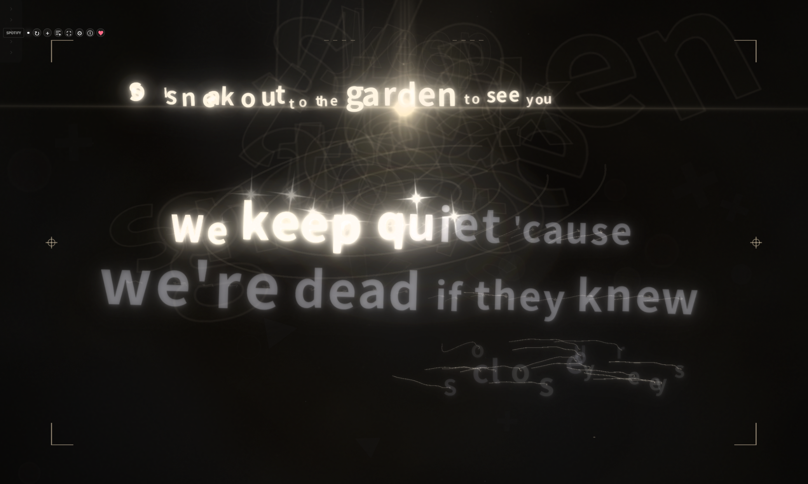

</details>

### English Stage

A dedicated lyric-PV presentation for English lyrics, with composition and
animation controls. Select **English Stage** in the mode selector to explore
its moving typography and layouts for longer lines. Word-level accuracy still
depends on the timing provided by your lyric source.

### JIZURA

An embedded engine, not a prerecorded video library. JIZURA creates a lyric PV
from the lyrics, timing, project settings, and selected effects. Themes,
seeds, and overrides can produce different arrangements.

### Folia-Derived Stages

The other modes offer different layouts and rendering styles adapted for
Spotify. This is not a claim of complete parity with every capability of the
original Folia host.

## Backgrounds and Customization

The background selector includes **Standard, Monet, Paper, Latent, Web, and
Starfield**. Controls vary by background and mode.

- Adjust typography, text colors, stage colors, and supported accent settings.
- Use **Match album art** where available to derive colors from the cover.
- Display translation or romanization when present in the source data.
- Explore mode-specific motion, visual, and background options.
- Use settings reset actions to restore the relevant defaults.

JIZURA renders its own scenes instead of sharing the normal background host.
Use its native background/effect controls for that mode.

<details>
<summary><strong>View stage settings, typography, and background controls</strong></summary>

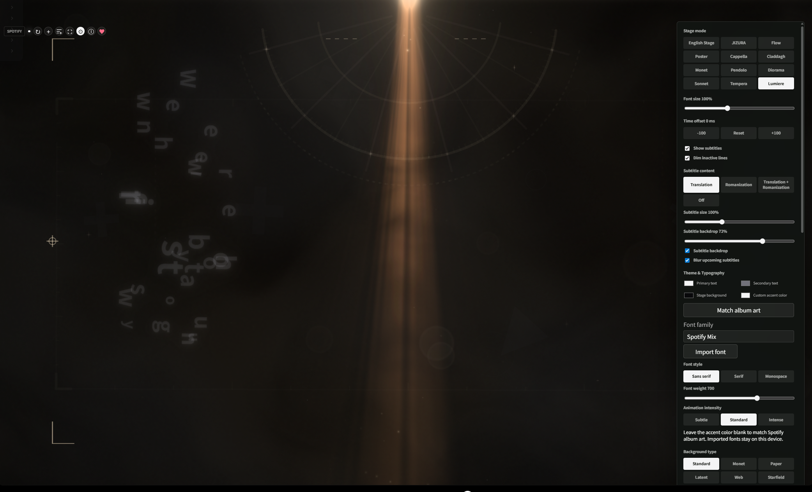

</details>

Settings are grouped by purpose. Start with the mode, font size, and subtitle
options, then adjust **Theme & Typography** and **Background type**. Some
controls appear only for the selected mode or background. Settings panels can
scroll independently of the stage.

## Lyrics and Timing

### Automatic Matching

Supported sources include local files, Spotify, LRCLIB, and NetEase Cloud Music.
Provider coverage varies. Different releases, live versions, or recordings of
a track may have different lyrics and timing.

Use **Search again** to retry matching. Automatic lookup does not guarantee the
correct recording or lyrics for every song.

### Import Your Own Lyrics

1. Prepare a lyric file you have permission to use.
2. Play the matching track in Spotify.
3. Click **+** and select the file.
4. Check the result and adjust the timing offset if needed.

Imports support **LRC, enhanced LRC, YRC, QRC, TTML, and plain text**. The
information available to the stage depends on the file; plain text alone does
not provide accurate word-level timestamps.

### Timing and Segmentation

- **Time offset:** correct early/late lyrics per track. A positive offset
  advances Folia's lyric clock; a negative offset delays it.
- **Word grouping:** open the segmentation icon and separate units with `/`.
  The units must reconstruct the original line exactly.
- **Timing precision:** segmentation changes grouping, not authentic word timing.
  It cannot recover timestamps absent from the source.
- **Subtitles:** translation and romanization require corresponding source data.

<details>
<summary><strong>View the word segmentation editor</strong></summary>

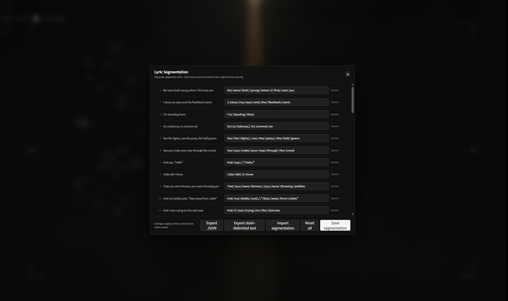

</details>

## JIZURA Workspace

| Area | Capabilities |
| --- | --- |
| Appearance | Themes, styles, moods, fonts, colors, and scene controls |
| Native effects | Layout, entrance, hold, exit, decoration, treatment, background, camera, FX, and transitions |
| Arrangement | Candidate pools, randomization, and supported locks |
| Line/cut editing | Overrides, manual segmentation, cut choices, timing, and parameter snapshots |
| Projects | Project import/export, per-track settings, undo/redo |
| Preview | Timeline tools and effect previews |
| Local audio | Analyze an authorized local audio file for audio-reactive planning |
| Offline export | AE JSON, LRC, WAV, PNG sequences, transparent/layered sequences, and MP4 where supported |

Advanced sections load when opened to reduce mode-switching overhead. Native
effects and editing tools remain available.

Audio-reactive behavior depends on available analysis data. Playing a Spotify
track does not guarantee access to raw audio or an analysis timeline. Local
analysis requires you to provide the appropriate audio file.

Export support depends on Spotify's embedded browser, codecs, and platform
APIs. MP4 and other upstream export capabilities may not work on every setup.

To explore these tools, select **JIZURA**, open **Settings**, and expand the
relevant editing section. Start with a theme before changing individual
effects. Export a project before making extensive overrides so you can keep
a portable copy of your arrangement.

## Updates

Open **Version information** to check Spotify Folia's release. When a newer
version is available, the app provides the PowerShell update command.

Installation and updates use the same command:

```powershell
irm https://raw.githubusercontent.com/m1570908333/spotify-folia/main/scripts/install.ps1 | iex
```

Updates are applied through PowerShell, not silently installed inside Spotify.
The version dialog tracks **Spotify Folia releases**, not separate upstream
Folia/JIZURA releases. The maintainer integrates upstream changes into new
Spotify Folia versions.

See [Releases](https://github.com/m1570908333/spotify-folia/releases) and
[CHANGELOG.md](CHANGELOG.md) for published changes.

## Troubleshooting

| Problem | What to check |
| --- | --- |
| `spicetify` is not recognized | Configure Spicetify first, reopen PowerShell, and check `spicetify --version` |
| Folia does not appear | Restart Spotify, check `spicetify config custom_apps` for `folia-stage`, then retry `spicetify apply` |
| `scripts/install-prototype.ps1` is not found | That script requires the source checkout and correct working directory; use the release one-liner for normal installation |
| No lyrics | Retry matching or import a synchronized file for the correct recording |
| Lyrics lead or lag | Adjust the track's time offset and verify the recording version |
| Imprecise word animation | Check for word timestamps; segmentation alone cannot supply them |
| JIZURA or 3D performance is poor | Try lighter effects, reduce optional effects, close unused previews, and check graphics acceleration |
| Web background is blank | The site may block embedding or require unavailable browser capabilities |
| An export is unavailable | The embedded browser may lack the encoder or file API; try another format |
| Download fails | Check access to GitHub, raw.githubusercontent.com, and GitHub release assets |
| Broken after a Spotify update | Check Spicetify compatibility/recovery instructions before reinstalling Folia |

For reports, include Spotify, Spicetify, and Spotify Folia versions, the stage,
reproduction steps, and a screenshot or recording. Do not include credentials,
tokens, or private media.

Report reproducible bugs through [Issues](https://github.com/m1570908333/spotify-folia/issues).
See [SECURITY.md](SECURITY.md) for security reporting.

## Limitations

- The supplied installer targets Windows; it does not cover macOS or Linux.
- Spotify/Spicetify host changes may require compatibility fixes.
- Lyrics, translation, romanization, and analysis availability vary by source.
- Smoothness depends on graphics hardware, effects, timing, and the host browser.
- Some original Folia/JIZURA capabilities depend on APIs unavailable in Spotify.
- This app does not download Spotify audio, unlock paid Spotify features, or
  provide a catalog of licensed music videos.

## Privacy

Local settings, lyric imports, and project data use the app's local browser
storage, not a cloud backup. Export important work before clearing storage or
moving to another device.

Online lyric searches send track-search information to the selected provider.
Version checks contact GitHub. Artwork, optional online fonts, and configured
web backgrounds can contact their respective hosts. Opening the support link
contacts PayPal.

Only import lyrics, fonts, audio, images, or video you have permission to use.
Do not publish copyrighted recordings merely to demonstrate the app.

## Support

Support helps maintain compatibility, fix bugs, and improve the lyric stages.
Open **Support this project** to view the packaged sponsor card, or use
[PayPal](https://www.paypal.me/syj8065).

The dialog may also appear on first use and at two-week intervals. Support is
optional and does not unlock additional features.

## Development

The Custom App source is in `prototype/folia-stage`.

```powershell
git clone https://github.com/m1570908333/spotify-folia.git
cd spotify-folia
powershell -NoProfile -ExecutionPolicy Bypass -File .\scripts\install-prototype.ps1
```

The source installer copies the current checkout into Spicetify. Rerun it after
edits to test them in Spotify. It does not publish changes to GitHub.

Run the smoke tests with Node.js from the repository root:

```powershell
Get-ChildItem tests/*-smoke.js | ForEach-Object { node $_.FullName; if ($LASTEXITCODE) { exit $LASTEXITCODE } }
```

Tests cover core behavior, stages, localization, release structure, UI, and
JIZURA workflows. They do not replace visual checks inside Spotify.

For releases, update `prototype/folia-stage/release-config.js`, the corresponding
release test, and `CHANGELOG.md`. Push the source and a `vX.Y.Z` tag. GitHub
Actions builds `spotify-folia.zip`, writes its SHA-256 checksum, and publishes
the release with the repository's standard `GITHUB_TOKEN` permission. Never
commit personal access tokens.

See [CONTRIBUTING.md](CONTRIBUTING.md) and the screenshot/video capture checklist
in [docs/MEDIA.md](docs/MEDIA.md).

### Repository and Release Layout

| Location | Purpose |
| --- | --- |
| `prototype/folia-stage/` | Installable Custom App and its required runtime assets |
| `adapter/`, `scripts/`, `tests/`, `tools/` | Integration source, build/install scripts, and development checks |
| `vendor/` | Upstream source snapshots and third-party licensing material |
| `docs/media/` | Screenshots used in this README |
| Git tags and GitHub Releases | Versioned source and downloadable installation archives |

The release workflow packages the Custom App, not the entire repository.
Documentation screenshots and development captures are not installed into
Spotify. Large local video recordings, backups, and optional local `github/`
exports are ignored by Git.

Use Git tags such as `v1.0.1` to identify published source versions rather than
committing duplicate version folders. To save a local source snapshot of an
existing tag from the repository root:

```powershell
New-Item -ItemType Directory -Force .\github | Out-Null
git archive --format=zip --output=github/spotify-folia-v1.0.1-source.zip v1.0.1
```

This exports the tagged source, not uncommitted changes and not the installable
release ZIP. For installation, use the `spotify-folia.zip` release asset instead.

## Credits and Licensing

Spotify Folia adapts visual work from Folia and embeds the JIZURA lyric-PV engine.
Please credit and support the upstream projects as well.

- [Folia](https://github.com/chthollyphile/folia-major)
- [JIZURA](https://github.com/852wa/JIZURA)
- [Spicetify CLI](https://github.com/spicetify/cli)

Spotify Folia is distributed under the **GNU Affero General Public License
v3.0**; see [LICENSE](LICENSE). Third-party components retain their own licenses
and notices. The JIZURA engine is MIT licensed; see the
[JIZURA notices](prototype/folia-stage/JIZURA-THIRD-PARTY-NOTICES.md) and accompanying
license files before redistributing modified builds.
